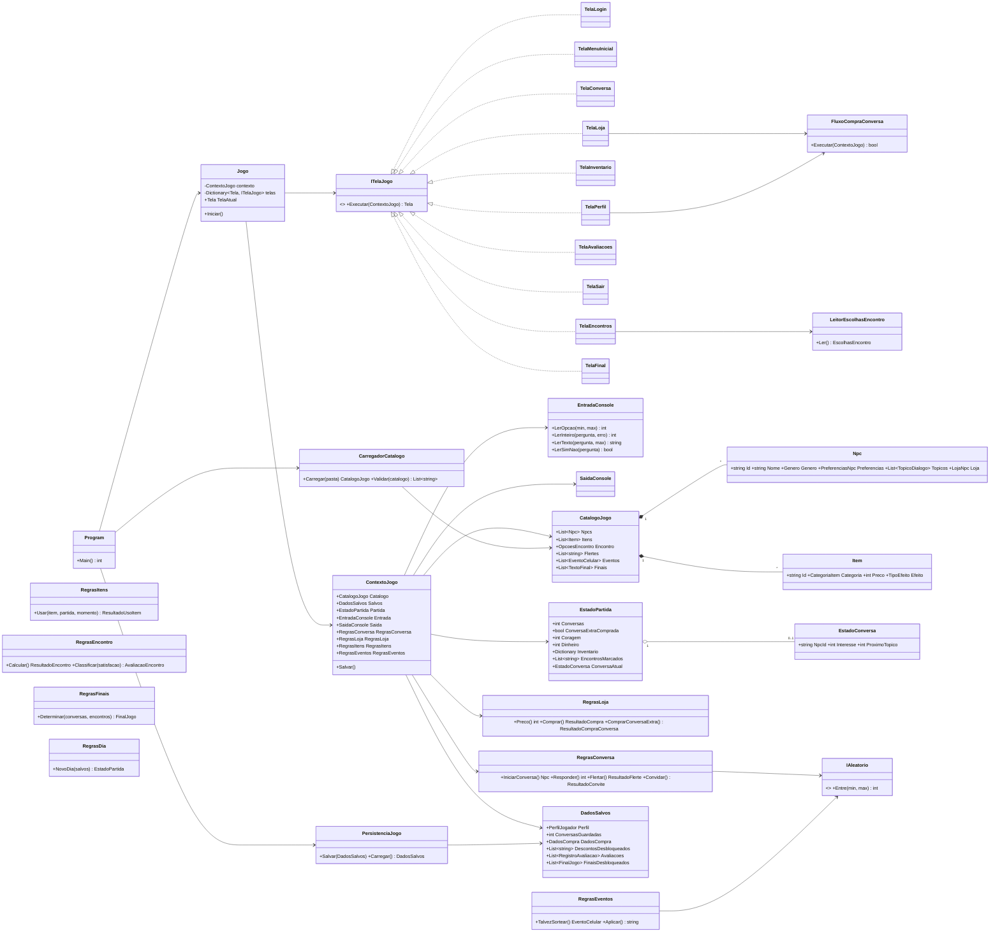
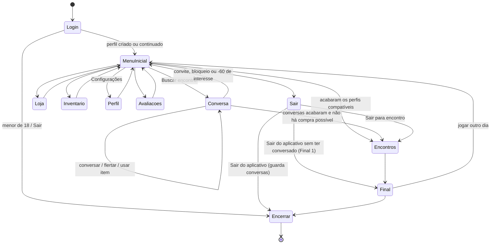

# Arquitetura

Na M2, `Jogo.cs` concentrava telas, leitura do teclado, decisões e atualização de dados, e a tela atual era um texto livre (`"MenuInicial"`, `"Conversa"`...). Na M3 o código foi dividido por responsabilidade:

| Pasta | Responsabilidade | Exemplos |
|---|---|---|
| `Dominio` | Dados do jogo, sem lógica de tela | `EstadoPartida`, `DadosSalvos`, `Npc`, `Item`, `Tela` (enum) |
| `Dados` | Conteúdo em JSON, leitura e validação | `CatalogoJogo`, `CarregadorCatalogo`, `npcs.json` |
| `Regras` | Regras do documento, sem `Console` (por isso são testáveis) | `RegrasConversa`, `RegrasLoja`, `RegrasEncontro`, `RegrasFinais` |
| `Telas` | O que cada tela mostra e pergunta; devolvem a próxima `Tela` | `TelaMenuInicial`, `TelaConversa`, `TelaEncontros` |
| `Interface` | Entrada validada e saída formatada | `EntradaConsole`, `SaidaConsole` |
| `Persistencia` | Arquivo de save | `PersistenciaJogo` |

`Jogo` só guarda a tela atual e chama a tela correspondente até chegar em `Tela.Encerrar`:

```csharp
while (TelaAtual != Tela.Encerrar)
{
    TelaAtual = _telas[TelaAtual].Executar(_contexto);
}
```

## Diagrama de classes



## Fluxo de telas



## Por que as regras não usam `Random`

As classes da pasta `Regras` recebem e devolvem dados (`ResultadoConvite`, `ResultadoCompraConversa`...). As telas decidem o que escrever a partir desses resultados. Assim os testes conseguem conferir as regras sem simular o teclado, e o sorteio pode ser controlado com `IAleatorio` (nos testes, `AleatorioFixo` escolhe o resultado do D20 e do convite).
